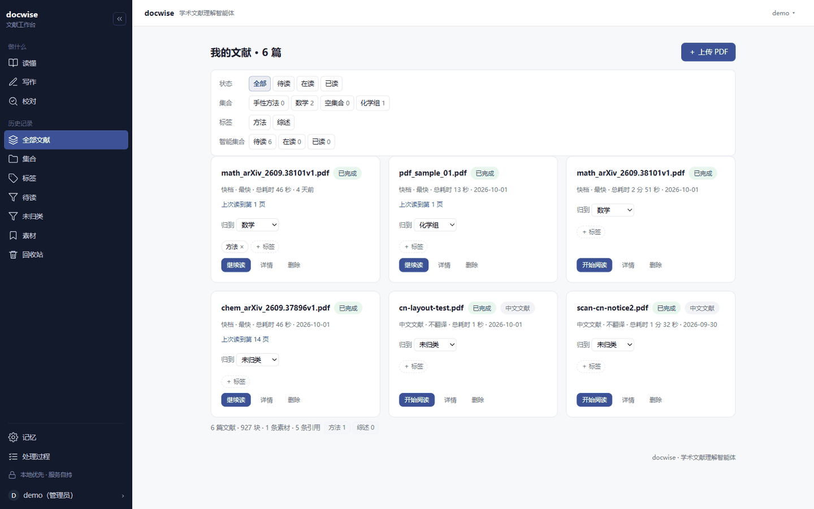
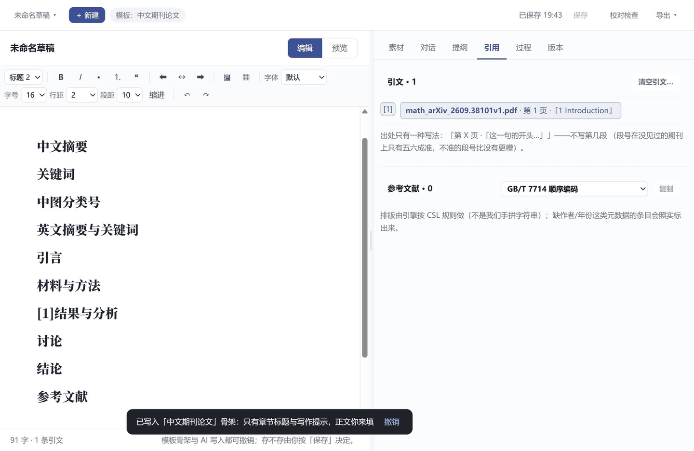
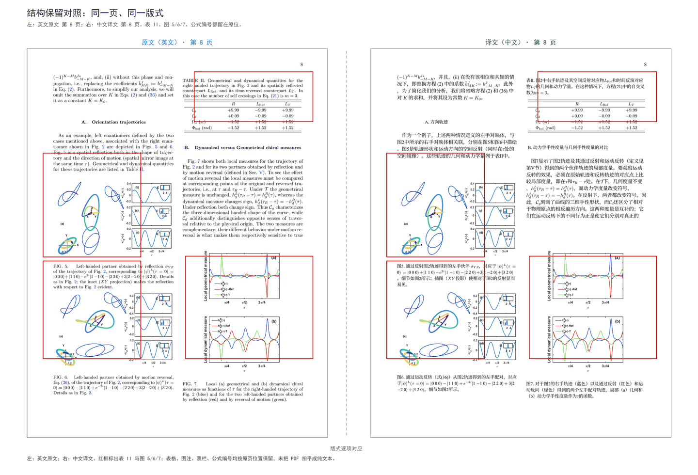
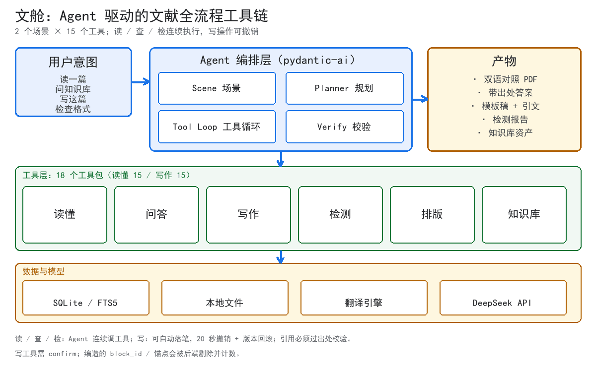
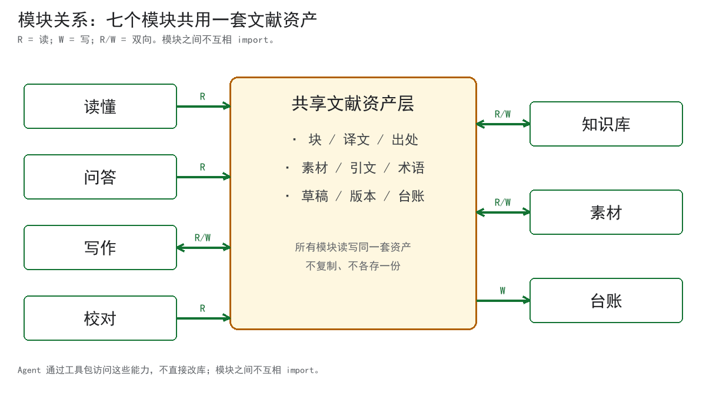

# 译研舱 · docwise

> 把一篇文献读成**可核对的笔记**，再把笔记写成**可投出去的稿子**。

<div align="center">
  <a href="docs/screenshots/readme-demo.gif">
    
  </a>
  <br>
  <sub>真实界面导览：库 → 双语精读 → 带出处问答 → 模板写作（GIF 由真实截图合成）</sub>
</div>

<p align="center">
  
  
  
  
</p>

**译研舱**是 **Agent 驱动的文献全流程工作台**：AI 调用工具完成**结构保留翻译、带出处问答、模板写作、检测**，并把素材 / 术语 / 引文 / 版本沉淀进知识库。

它不是“整篇译文 + 一个聊天框”：

- **读懂**：原文/译文按块对照，结论点回原文那一句；
- **问**：Agent 自己查库、读段、找术语、看图表，答案带可定位出处；
- **写**：5 种期刊骨架 + 素材/引文 + 逐处字体字号，AI 可落笔、可撤销；
- **存**：素材 / 术语 / 引文 / 草稿 / 版本 / 台账共用一套资产。

## 四张图看懂

<table>
  <tr>
    <td width="50%" align="center">
      <br>
      <sub><b>01 文献库</b>：一篇文献一个任务，集合/标签/素材都在</sub>
    </td>
    <td width="50%" align="center">
      <br>
      <sub><b>02 双语精读</b>：原文小字、译文主文，点结论回原文</sub>
    </td>
  </tr>
  <tr>
    <td width="50%" align="center">
      <br>
      <sub><b>03 带出处问答</b>：答案只保留工具真返回的块</sub>
    </td>
    <td width="50%" align="center">
      <br>
      <sub><b>04 模板写作</b>：期刊骨架 + 素材→[1] 引文 + 字号</sub>
    </td>
  </tr>
</table>

## 结构保留，不是把 PDF 拍平



左边原文第 8 页，右边译文第 8 页：表 II、图 5/6/7 都在原位；段落、图注、公式编号没有被打散。

翻译与排版由**排版翻译引擎**完成；本仓库负责**块协议、译文回填、出处校验、交互与写作闭环**——不把引擎内部算法当成自己的实现。

## Agent：不是聊天框



两个场景各挂 15 个工具：

- **读懂场景**：`search_library` / `read_blocks` / `list_sections` / `read_section` / `compare_documents` / `list_figures` / `read_figure` / `build_matrix` / `list_collections` …
- **写作场景**：`read_draft` / `search_library` / `read_blocks` / `list_citations` / `suggest_citation` / `run_check` / `format_bibliography` / `list_materials` / `preview_styles` / `apply_style` …

例如：

- **问**：“库里讲手性的文献有哪些？” → Agent 先列任务、再检索、读段、看导读，最后用 `build_matrix` 做综述矩阵；
- **写**：“按中文期刊模板搭骨架，正文小四、标题二号。” → Agent 读草稿、加载体例/排版技能、预览并应用样式，再把正文写进 `ops`；
- **检**：“这句该引没引？” → Agent 查库、读段、跑 `run_check`、给候选 `suggest_citation`。

> **Agent 边界**：读 / 查 / 检可连续调用工具；写操作需 `confirm`，可 **20 秒整批撤销**、可版本回滚；不自动投稿，不承诺一键写完整篇。

更多工具清单见 [docs/AGENT.md](docs/AGENT.md)。

## 技术栈

`Vue 3.5 + Vite + Naive UI + TipTap + pdf.js` ｜ `FastAPI + SQLAlchemy 2 + SQLite` ｜ `pydantic-ai` ｜ `排版翻译引擎（子进程）` ｜ `DeepSeek API`

## 模块关系



读懂 / 问答 / 写作 / 校对 / 知识库 / 素材 / 台账七个模块围着**共享文献资产层**；R 是读、W 是写、R/W 是双向；模块之间不互相 `import`，也不各存一份数据。

## 快速开始

### 引擎（装一次，随仓库内置）

```bash
uv sync --project engine     # 引擎依赖装进 engine/.venv，后端自动找到它
```

### 后端

```bash
cd backend
uv sync
uv run uvicorn app.main:app --port 8000
```

### 前端

```bash
cd frontend
bun install
bun dev
```

### 一个地址（同源部署）

```bash
cd frontend && bun run build
cd ../backend && uv run uvicorn app.main:app --host 0.0.0.0 --port 8000
```

打开 `http://127.0.0.1:8000/`。详细步骤、模型密钥与引擎说明见下文。

## 现在有什么（**已在 main 上可用**）

外文文献译成中文并保留原排版（双语对照稿 / 纯中文稿可下载）；**中文文献不翻译**，直接抽文字层进理解层；
在此之上做**结构化导读**（研究问题 / 方法 / 结论 / 创新点 / 贡献，每条可点回原文）、**统一术语表**、
**带出处的论文问答**；以及阅读位置记忆、任务取消 / 重试 / 删除、账号与任务归属、诚实进度。

| 能力 | 状态 |
| --- | --- |
| 上传 → 取字 → 分块 → 翻译 → 出稿（双语 / 纯中文），SSE 实时进度 | ✅ |
| **中文文献**不翻译，直接抽字进理解层（导读 / 术语 / 问答都能用） | ✅ |
| **扫描件**（无文字层）自动走**本地 OCR** 兜底，离线、零成本；界面如实标注"字由 OCR 识别，可能有个别错字" | ✅ |
| **块分级**：每块判成 题名 / 章节标题 / 图注 / 正文，段落精读据此分层 | ✅ |
| **目录**：把认出来的标题变成可点的跳转（点一条滚到原文并高亮） | ✅ |
| 出处**只说「第 X 页 ·「这一句的开头…」」**，不说第几段 | ✅ |
| 账号体系（注册 / 登录 / 会话可吊销 / 管理后台）、任务归属（非本人一律 404） | ✅ |
| 诚实进度：解析引擎日志里的真实页进度；解析不出就说"引擎还没报进度"，**绝不编百分比** | ✅ |
| 同源部署：一个地址同时给页面与接口（手机真机可直接用） | ✅ |
| **模块化形态**（左栏 + 知识库 + 起草 + 收口 + 个人中心台账） | 🟡 **主体已落地，M0–M7 细化中** |

## 写作模块：现在就能用

> 写作页不是占位：下面这些能力已在 main 上可用，不需要等整块形态全部落地。

| 能力 | 状态 |
| --- | --- |
| 富文本编辑器：标题级别 / 加粗斜体 / 对齐 / 列表 / 引用 / **逐处字体与字号** / 行距·段距·缩进 | ✅ |
| **期刊体例模板 5 种**（中文期刊 GB/T 7714 · 英文期刊 APA 7 · IEEE 会议 · 学位论文 · 研究报告），一键写入章节骨架（只写标题，不塞提示文字） | ✅ |
| 素材 → 引文：插入自动编号 `[1]`，点回原文那几句 | ✅ |
| 参考文献排版（CSL：GB/T 7714 / APA / IEEE），缺字段如实标出 | ✅ |
| **AI 助手可写正文**：`ops` 直接写入 + **20 秒撤销** + **每次保存留版本**；也可只给逐句改写建议 | ✅ |
| **版本历史**：列表/预览/回滚（回滚前自动留档，所以回滚本身可回滚） | ✅ |
| 导出 `.md` / `.docx`（正文 + 参考文献） | ✅ |
| 校对检查（该引未引 / 格式自检 / 无法判断三分栏） | ✅ |
| 草稿**双存**：`body_html`（富文本源，逐段字体字号）+ `body_md`（派生，供引文/提纲/导出/AI 锚点校验） | ✅ |

**写作页布局**：两栏「写作 ｜ 助手」，右侧六个页签（素材 · 对话 · 提纲 · 引用 · 过程 · 版本）。
素材原先是独立一栏，2026-10-19 并入右栏——正文宽度 508px → 703px（+38%）。

**交互约定**（用户明确要求，改这块前先读）：
AI 可以往正文里写，但必须**可撤销 + 可回滚 + 界面标注**；模板**只写标题**；
字体字号是**逐处的**；页签**互斥**；助手输出**流式**（步骤逐条入场、正文逐字出现）。

**开发文档**：见 [docs/](docs/)（代码架构、接口/数据/前端契约、Agent 工具箱、产品形态）。

### ⚠️ 档位只有两个：快 / 中

⭐⭐ **精档已从界面撤下（2026-09-30）**，理由留在这里当规矩：它在 `engine/registry.py` 里**一直映射到中档**（没有审校步骤），
而界面上写着"最准，多一道审校"——**这是不实宣称**。在做出来之前**不提供这个选项、也不在任何地方承诺它**。
后端 `Tier.PRECISE` 枚举**故意保留**（老任务数据与 `Tier()` 校验还要用）。
**规矩：界面上每一个能力描述，都要能在代码里指出它对应的实现；指不出来就不许写。**

> 翻译与排版由**排版翻译引擎**完成（快 / 中两档）。

## 阶段 0（已完成，2026-08-06 验收通过）

目标：仓库、后端、前端、数据库可启动。

验收标准：**未参与搭建的队友，从 git clone 全新仓库开始，按本 README 操作，十分钟内跑起来看到首页**。

## 开发路线（2026-08-26 修订）

> 翻译与排版由**排版翻译引擎**承担；本仓库专注**块协议、回填、出处校验、交互与写作闭环**。
> ⚠️ 档位**只有快 / 中两档**（精档已撤下，理由见上文）。
> ⚠️ **本表是早期路线（2026-08 定），已部分被形态 v2 的 M0–M7 取代**——两者不冲突：本表讲的是**引擎与质量**这条线，
> v2 讲的是**产品形态**（左栏 / 知识库 / 起草 / 收口）。看形态请看 [`docs/PRODUCT.md`](docs/PRODUCT.md)。

| 阶段 | 内容 | 状态 |
| --- | --- | --- |
| 0 | 项目骨架（后端/前端/数据库可启动） | ✅ 已完成（2026-08-06 验收通过） |
| 1 | 最小翻译链路：接排版翻译引擎（快档）跑通"取字→翻译→出稿"，保证每块状态可见、不静默截断 | ✅ 已完成并验收（2026-08-28，PR #13–#17） |
| 2 | Web 端闭环（MVP）：上传/进度/预览/下载/历史 + 档位选择 + 中档引擎；SSE+轮询 | ✅ 已完成（2026-09，B1/B2/C1–C4/A1 全部合并） |
| 3 | 中间表示 DOM（v1 标题/段落/图片）+ 引擎编排强化，吸收排版翻译引擎的结构化产物 | 待开工 |
| 4 | 轻量角色化编排 + **质检打回闭环**（翻译 / 排版决策 / 审校 + 交叉验证） | 待开工（**这就是精档要做的事**，做完才谈得上开放精档） |
| 5 | 知识库与记忆：术语表/用户偏好/跨章节一致 + 对接排版翻译引擎自动术语抽取 | 待开工 |
| 6 | 扫描件/图片通道：**本地 OCR 兜底已通**（中文扫描件 + 跨语言逐段翻译，2026-09-30）；视觉三方分工待开工 | 🟡 部分完成 |
| 7 | 质量评估与回归（固定测试集约 20 篇） | 待开工 |

### 2026 交付批次（阅读工作台）

> ⚠️ **这是 v1 形态的交付记录**（单页 + 库/读两级）；形态的细化见下面的「模块化形态」。
> 表里每一行都对应 main 上已合并的 PR——**没合并的不写进来**（早期这三行写过"🚧 待推送"，其实早已合了）。

在路线表阶段 2 之上，2026 交付版本按 M0–M4 分批落地，**均已完成并合并**：

| 批次 | 内容 | 状态 |
| --- | --- | --- |
| M0/M1 | DeepSeek 客户端 + 导读/术语理解层（惰性按需、可溯源） | ✅ PR #42 |
| M2 | 阅读工作台（双语稿 / 导读 / 术语表 页签 + 点溯源抽屉） | ✅ PR #43 |
| M3 | 移动端 PWA（可装主屏/离线壳；`/api` 全部走可配绝对 base） | ✅ PR #44 |
| M4 | 论文问答（整篇入上下文 + 超长时 FTS5 兜底，答案带 block_id 出处） | ✅ PR #45 |
| 补门 | 历史「继续读」与上传后共用同一工作台；修复问答检索跨论文串库；撤下未实现宣称 | ✅ PR #46 |
| 保命基建 | 日志 + worker 韧性 + 真健康检查 + SQLite WAL | ✅ PR #47 |
| B 批 | 账号体系：注册/登录/会话票据、每篇论文有主人（非本人 404）、管理后台 | ✅ PR #49 |
| E 批 | 任务生命周期：取消（真杀掉引擎子进程）/ 重试 / 删除 + 磁盘治理与备份 | ✅ PR #50 |
| F 批 | 诚实进度：解析引擎日志里的真实分页进度与预计剩余，解析不出就说"引擎还没报进度" | ✅ PR #51 |
| 同源部署 | 后端托管前端产物：一个地址同时提供页面与接口，演示与真机不用再拼 `?apiBase=` | ✅ PR #52 |
| 中文文献 | 对象是文献本身：中文文献不翻译，直接抽文字层进理解层；导读在超长文献上抽样 + 截断抢救 | ✅ PR #54 |
| **形态 v1（两级结构）** | **L1「我的论文」库页 / L2 全屏阅读工作区**：库与读分开、各有各的位置；阅读区改成左文档 + 右助手（问答 / 导读 / 术语 三个副页签）；档位统一写法并在文案里标明来源；次要动作收进 `⋯` 菜单 | ✅ PR #57 |
| 扫描件通道 | 无文字层的扫描件自动走**本地 OCR** 兜底（离线零成本）；跨语言扫描件再走逐段翻译；界面如实标注"文字由 OCR 识别" | ✅ PR #63 |
| 块分级 | 每块判成 **题名 / 章节标题 / 图注 / 正文**，段落精读据此分层 | ✅ PR #64 |
| 引擎版面量 | 外文文献那条路也带上**字号与位置**；补上标题召回（不再因字体正则误判而整段丢失） | ✅ PR #69 / #70 |
| 目录与时间口径 | 段落精读左栏可折叠**目录**；时间戳统一 UTC 口径 | ✅ PR #71 / #73 |

> **当前进度**：阶段 0 / 1 / 2 ✅ · 2026 交付批次（补门 / 保命基建 / 账号体系 / 任务生命周期 / 诚实进度 / 同源部署 / 中文文献 / 形态 v1 / 扫描件 / 块分级 / 目录）✅。
> 形态 v1 的线框图见 [`docs/records/product-form-v1.md`](docs/records/product-form-v1.md)（⚠️ **已被 v2 取代，仅作历史记录**），
> 可点开的形态原型见 [`docs/design/product-form.html`](docs/design/product-form.html)（双击即开，含交互示意）。

## 模块化形态（主体已落地，细化中）

**左侧常驻导航（上段"做什么" + 下段"我的库"）+ 右侧工作区**，三个模块**彼此独立又可以合作**：

- **读懂** → 升级成**知识库**：集合（播放列表式，**一篇可属多个**）+ 标签（主题 / 方法 / **状态**）+ **智能集合**（规则可见）+ 素材 / 引用计数；
- **起草** → **不需要先有文献**；素材栏按集合 / 标签筛；插引文后点 `[1]` 回原文高亮；
- **收口** → 是**起草页里的检查抽屉**（不是独立页面）：该引未引 / 术语一致性 / 格式自检最小必要集；
- **个人中心**（整页）→ 含 **我的数据**（导出 / 磁盘占用）与 **AI 使用台账**（环节 × 数据流向 × 可导出 CSV / Markdown）。

落地分 **M0–M7**，顺序与依赖见 **[任务划分与分工](docs/records/task-plan-v1.md)**；
**形态的权威是 [`docs/PRODUCT.md`](docs/PRODUCT.md)**。
⚠️ **`App.vue` 已拆到 836 行**；`WriteView.vue` 仍有 1930 行，多人同时改它之前先看前端契约。

> 📌 **两点如实说明**（写在仓库里，免得被当成已实现）：
> ① **Agent 边界**：读懂/写作两个场景各挂 15 个工具；读/查/检可连续调用，写操作需 `confirm`、20 秒撤销、版本回滚；**不自动投稿、不承诺一键写完整篇**。
> ② **数据口径**：取字与扫描件 OCR 是本地；外文翻译、扫描件逐段翻译、导读/问答仍调用云端模型 API。准确说法是「**服务自持 + 文献存本地**」，不是"数据不出本机"。
> ⚠️ **`App.vue` 仍是较大的单文件**，拆分是后续任务——**拆完之前不要多人同时改它**。

## ⭐ 三份契约（**改接口 / 数据结构 / 前端命名之前先读它们**）

**在动手改代码之前，先读这三份契约**——它们是各自领域里的**唯一权威**（2026-10-14 冻结，PR #78）。
理由很实在：五个人同时开发，不把接口、数据模型、前端命名定死，就会各写一套，最后合不起来。

| 契约 | 管什么 |
| --- | --- |
| [接口契约](docs/contracts/api.md) | 当前 **85 个端点**的基线（路径 / 请求体 / 响应 / 错误码），新增端点只许追加。**加字段只许追加，改语义要先改这份文件** |
| [数据模型契约](docs/contracts/data-model.md) | 已有 **7 张表**（只许加列）+ 本期新增 10 张的字段 / 约束 / 索引；**迁移的八条硬规矩**；`memory_events` 为什么是三方共用的地基 |
| [前端命名与拆分契约](docs/contracts/frontend.md) | `views/` 拆分方案、哈希路由的四个函数签名、**199 个老类名的冻结清单**、设计 token 变量名、图标与 emoji 清单、测试契约 |

配套还有两份给组员看的：

- [任务划分与分工](docs/records/task-plan-v1.md) —— 角色位、任务总表（分支名 / 状态）、逐人任务卡。
- [组员入门指南](docs/guides/onboarding.md)

> **一句话规矩**：**实现与契约不一致时，以契约为准改代码**；如果确实是契约写错了，**先改契约再改代码**（同一条 PR 里都行），别让两边长期不一致。

## 开发约定（**提交 PR 之前必须做的四件事**）

完整规矩见 [CONTRIBUTING.md](CONTRIBUTING.md)，版本变化见 [CHANGELOG.md](CHANGELOG.md)。

1. **跑全量检查**（照 CI 的步子来；CI 在 `backend/` 与 `frontend/` 各有一个 job）：

   ```bash
   # 后端（ruff 是整个 backend，含 scripts/ —— 只查 app tests 会漏）
   cd backend && uv run ruff check . && uv run pytest -q

   # 前端（vitest 渲染冒烟 + vite build）
   cd frontend && bun run test && bun run build
   ```

2. **一个任务一条分支，从最新 main 拉**；分支名 `feat/` `fix/` `docs/` `chore/` 前缀。
   ⚠️ **不要堆叠 PR**（在别人还没合的分支上再拉分支）；⚠️ **不要对已开 PR 的分支 `force-push`**（那条 PR 会被 GitHub 永久冻住）。
3. **公开仓库红线**：提交前扫一遍改动（**含注释、文档字符串与提交信息本身**）——不得出现参考项目的真实名字、真实姓名、评审相关字样、任何密钥。
   扫描脚本**必须用 `git ls-files -z`**：带中文名的路径在普通输出里是转义的，按普通输出拼路径会**静默跳过**，扫出"干净"的假象。
4. **界面改动在 PR 里贴截图**。

### 三条不能碰的边界

- ⚠️ **`backend/data/` 里的真实数据一个字节都不能动**（要改走脚本：**默认只预览，`--apply` 才写，必须幂等**）。
- ⚠️ **`backend/app/blocktypes.py` 是块类型的唯一权威**——别在别处再写一套判级。
- ⚠️ **运行时依赖有上限**：后端只允许 6 个包（`fastapi` / `python-multipart` / `uvicorn[standard]` / `sqlalchemy` / `pydantic-settings` / `httpx`）。
  加依赖要单独论证；**重的依赖放独立 venv，用子进程调**——内置引擎 `engine/` 就是按这条走的（它有自己的 `pyproject.toml` 与 `.venv`）。

### 前端改动的两条硬约束

- ⚠️ **结构类名不许改、不许删**：`frontend/tests/app.smoke.test.js` 里有一份 `FORBIDDEN_LEGACY` 黑名单与一批结构断言，
  它们**锁着原型的类名**（`reader-card` / `workbench-head` / `ask-panel` … 一律不许出现）。**改样式安全，改类名会让用例变红。**
- ⚠️ **模板里要渲染的值一律用 `computed` 或 `ref`**（别用普通函数）：真出过事故——少写一对括号，Vue 会把**整个函数源码印在页面上**，而 `vite build` 一声不吭。

## 目录结构

```text
docwise-web/
├── backend/    # FastAPI 后端（Python）：app/ 应用代码、tests/ 测试、scripts/ 运维脚本
├── engine/     # 排版翻译引擎（随仓库内置，独立虚拟环境）：翻译包装脚本、版面模型调用、CSL 样式
├── frontend/   # Vue3 + Naive UI 前端：src/ 源码、public/ PWA 资源、prototype/ 设计原型
├── docs/       # 契约与长期文档：三份契约、代码架构图、产品形态说明、任务划分、组员入门指南、各阶段验收记录
└── .github/    # CI（后端 + 前端两个 job）、PR 模板、任务自动认领 workflow
```

## 引擎（随仓库内置，装一次即可）

翻译与排版由 `engine/` 承担，**不需要再克隆任何外部仓库，也不需要配任何引擎路径**。它有自己的依赖树（版面模型、PDF 解析、字体与 CSL 样式），所以单独建一个虚拟环境：

```bash
uv sync --project engine   # 首次需联网，几分钟；产物在 engine/.venv
```

- 后端会自动找到 `engine/.venv` 与 `engine/run_translation.py`，零配置。
- 首次翻译时引擎会**联网下载一次版面模型**（约百 MB，之后走本地缓存），这是唯一需要网络的一次性动作。
- 引擎仍需要一个大模型服务来翻译：在 `backend/.env` 里配 `DEEPSEEK_API_KEY`（见下节）。
- 引擎里有第三方组件，其许可证与改动说明集中在 `engine/THIRD_PARTY/`，**请勿删除**。

## 后端启动（约 3 分钟）

前置：安装 [uv](https://docs.astral.sh/uv/)（Python 包与环境管理器）。Windows 可用 `pip install uv`，或按官网说明安装。

```bash
cd backend
uv sync        # 自动创建 .venv 并安装依赖（首次需联网，几分钟）
uv run uvicorn app.main:app --port 8000
```

启动后验证：

- 打开 http://127.0.0.1:8000/api/health ，返回 `{"status":"ok",...}` 即后端正常。
- 打开 http://127.0.0.1:8000/api/tasks ，返回任务列表（初始为空数组）。
- 数据库为 SQLite，首次启动自动建表，文件在 `backend/data/docwise.db`（不提交仓库）。

> 引擎已随仓库内置（`engine/`），后端默认就指向它，**不需要再配引擎路径**。
> 唯一需要手动配置的是大模型服务：把 `backend/.env.example` 复制为 `backend/.env`，填 `DEEPSEEK_API_KEY`。
> 没填时界面照常能用，上传会失败并**明确说明原因**（"未配置模型服务"），不会静默卡住。
> 只有你想把引擎换到别处时，才需要设 `DOCWISE_ENGINE_PYTHON` / `DOCWISE_ENGINE_SCRIPT` / `DOCWISE_ENGINE_SERVICE`。

## 前端启动（约 2 分钟）

前置：安装 [bun](https://bun.sh/)（JS/TS 包与环境管理器，自带运行时，无需单独安装
Node.js）。Windows 可执行 `powershell -c "irm bun.sh/install.ps1 | iex"`，或按官网说明安装。

```bash
cd frontend
bun install   # 首次需联网安装依赖
bun dev       # 启动开发服务器
```

> 注意：不要直接双击 `frontend/index.html` 打开（会白屏），必须通过 `bun dev`
> 启动后访问 http://localhost:5173 。

启动后验证：

- 打开 http://127.0.0.1:5173 ，看到「我的论文」库页（**空库时**出 hero「把文献读懂」+ 上传卡）：可上传 PDF 并选**文献语言**（外文文献 / 中文文献）与档位（**快 / 中**），自动开始处理并**实时显示进度（SSE）**，完成 / 失败有提示。
- 先启动后端时，首页底部显示「后端状态：已连接」及任务数量；未启动则显示未连接。
- 前端 `/api` 由 Vite 代理到 http://127.0.0.1:8000（后端），无需额外 CORS 配置。

## 一个地址跑起来（同源部署，推荐演示与手机真机用）

后端可以直接托管前端构建产物：**构建一次前端，然后只起后端**，手机与同事的电脑访问同一个地址即可
（不用在网址上拼 `?apiBase=`，也不用配 CORS）。

```bash
# 1) 构建前端（产物落在 frontend/dist，不进仓库）
cd frontend
bun install
bun run build

# 2) 起后端，监听所有网卡（手机才连得上）
cd ../backend
uv run uvicorn app.main:app --host 0.0.0.0 --port 8000
```

- 本机打开 http://127.0.0.1:8000/ ；手机连同一个 Wi-Fi 后打开 `http://<电脑局域网IP>:8000/`
  —— **启动日志会直接列出本机的局域网地址**，抄下来就能用。
- 换端口改 `--port` 即可；若手机连不上，先确认是同一个 Wi-Fi，再放行 Windows 防火墙对该端口的入站。
- 没构建前端也能照常起后端（只提供 API，日志提示"未找到前端产物"）；
  想彻底关掉托管设 `DOCWISE_SERVE_FRONTEND=0`，产物在别处设 `DOCWISE_FRONTEND_DIST=<路径>`。

> **手机侧的一个前提（与"装主屏"有关）**：浏览器只在**安全上下文**里启用 Service Worker ——
> `localhost` / `127.0.0.1` 算安全，`http://<局域网IP>` **不算**。所以用 http + 局域网 IP 打开时，
> 页面与接口都正常，但**离线壳与"安装应用"入口拿不到**（应用本身不受影响，会自动跳过 SW 注册）。
> 三条可行路线：① 电脑本机用 `http://localhost:8000/` 演示 PWA；② 手机 Chrome 打开
> `chrome://flags/#unsafely-treat-insecure-origin-as-secure`，把该局域网地址加白（仅调试）；
> ③ 给后端配自签证书走 HTTPS（`uvicorn --ssl-keyfile/--ssl-certfile`），手机首次访问手动信任证书。
- **改完前端要重新 `bun run build`**：后端只负责把 `frontend/dist` 端出去，不会替你编译。

## 阶段 0 验收方式

1. `git clone` 本仓库（全新克隆，不用旧环境）。
2. 严格按"后端启动"与"前端启动"两节操作，全程计时。
3. 十分钟内看到前端首页，且后端健康检查通过，即验收通过。
4. 验收记录（截图 + 步骤 + 卡点）提交到仓库或群里。

## 约定

- API key 等密钥一律进本地 `.env`，**绝不提交仓库**。
- 提交信息使用 Conventional Commits：`feat(scope): message`。
- 数据库访问统一走 SQLAlchemy ORM，将来换 PostgreSQL 只改配置。

## 许可证

- 本仓库的**自身代码**（backend / frontend / 文档）采用 **MIT**，见 [`LICENSE`](LICENSE)。
- **`engine/` 不是 MIT**：其中的排版翻译引擎为 **AGPL-3.0**，参考文献样式数据为 **CC BY-SA 3.0**。
  分发或基于本项目提供网络服务时，需遵守这两个许可证；具体声明与改动说明见
  [`engine/THIRD_PARTY/NOTICE.md`](engine/THIRD_PARTY/NOTICE.md)（**请勿删除该目录**）。
