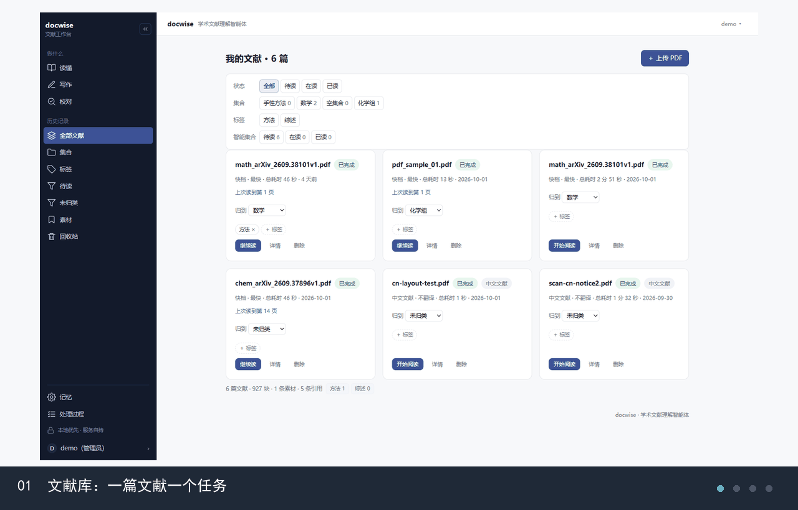
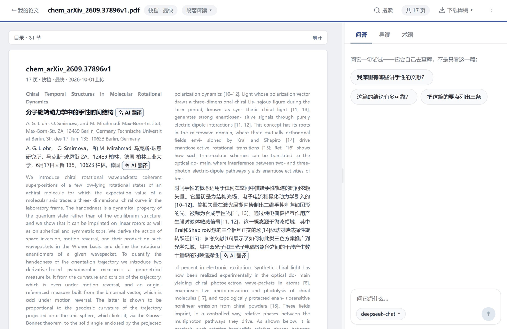
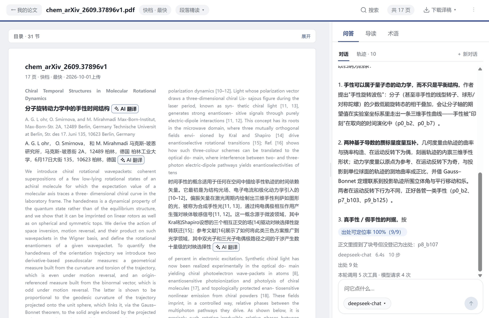

# 译研舱 · docwise

> 把一篇文献读成**可核对的笔记**，再把笔记写成**可投出去的稿子**。

<div align="center">
  <a href="docs/screenshots/readme-demo.gif">
    
  </a>
  <br>
  <sub>真实界面导览：库 → 双语精读 → 带出处问答 → 模板写作</sub>
</div>

<p align="center">
  
  
  
  
</p>

**译研舱**是一个面向研究者的文献工作台：把外文论文译成中文并保留原排版，在译文上做精读、问答与笔记，最后用这些素材写成一篇带引文的稿子。

它不是"整篇译文 + 一个聊天框"：

- **读懂**：原文与译文按块对照，结论能点回原文那一句；
- **问**：AI 自己查库、读段、找术语、看图表，答案带可定位出处；
- **写**：期刊骨架 + 素材与引文 + 逐处字体字号，AI 可落笔、可撤销；
- **存**：素材、术语、引文、草稿、版本共用一套资产。

## 界面

<table>
  <tr>
    <td width="50%" align="center">
      <br>
      <sub><b>文献库</b>：一篇文献一个任务，集合与标签都在</sub>
    </td>
    <td width="50%" align="center">
      <br>
      <sub><b>双语精读</b>：原文小字、译文主文，点结论回原文</sub>
    </td>
  </tr>
  <tr>
    <td width="50%" align="center">
      <br>
      <sub><b>带出处问答</b>：答案只保留实际读到的段落</sub>
    </td>
    <td width="50%" align="center">
      <br>
      <sub><b>模板写作</b>：期刊骨架 + 素材转引文 + 字号</sub>
    </td>
  </tr>
</table>

## 结构保留，不是把 PDF 拍平


左边是原文第 8 页，右边是译文第 8 页：表格、插图、公式编号都在原位，段落与图注没有被打散。译文以双语对照稿或纯中文稿下载。

## 能做什么

- **翻译与阅读**：上传 PDF，自动取字、分块、按版面翻译；扫描件走本地 OCR 兜底；中文文献不翻译，直接进理解层。
- **精读**：段落对照、可折叠目录、阅读位置记忆，任意结论都能点回原文。
- **问答与导读**：整篇入上下文的问答，附结构化导读与统一术语表，出处精确到"第 X 页 ·「这一句的开头…」"。
- **写作**：5 种期刊体例模板，素材一键转 `[1]` 引文，参考文献按 GB/T 7714、APA、IEEE 排版，导出 `.md` / `.docx`。
- **知识库**：集合、标签、智能集合、素材与回收站，跨文献复用。

两点如实说明：

- **数据口径**：取字与 OCR 在本地完成；翻译、导读、问答会调用云端模型 API。准确说法是"服务自持 + 文献存本地"，不是"数据不出本机"。
- **AI 边界**：可以连续查、读、检；写操作需要确认，可整批撤销与版本回滚；不自动投稿，也不承诺一键写完整篇。

## 技术栈

`Vue 3 + Vite + Naive UI + TipTap + pdf.js` ｜ `FastAPI + SQLAlchemy + SQLite` ｜ `pydantic-ai` ｜ `DeepSeek API` ｜ 内置排版翻译引擎（Python 子进程）

## 快速开始

前置：[uv](https://docs.astral.sh/uv/)（Python 3.12）与 [bun](https://bun.sh/)。前端不需要单独装 Node。

### 1. 装引擎依赖（只需一次）

```bash
uv sync --project engine
```

引擎随仓库内置在 `engine/`，有自己的虚拟环境；后端会自动找到它，不需要配置路径。首次翻译会联网下载一次版面模型（约百 MB），之后走本地缓存。

### 2. 配置模型密钥

```bash
cp backend/.env.example backend/.env
# 编辑 backend/.env，填 DEEPSEEK_API_KEY
```

不填也能启动与浏览界面，只是上传后会失败，并明确提示"未配置模型服务"。

### 3. 启动后端

```bash
cd backend
uv sync
uv run uvicorn app.main:app --port 8000
```

访问 http://127.0.0.1:8000/api/health ，返回 `{"status":"ok"}` 即正常。

### 4. 启动前端

```bash
cd frontend
bun install
bun dev
```

打开 http://localhost:5173 。不要直接双击 `index.html`（会白屏）。

### 一个地址运行（推荐用于演示）

```bash
cd frontend && bun run build
cd ../backend && uv run uvicorn app.main:app --host 0.0.0.0 --port 8000
```

后端会直接托管前端产物，打开 http://127.0.0.1:8000/ 即可，同局域网的其他设备也能访问。

## 目录结构

```text
docwise-web/
├── backend/    # FastAPI 后端：路由、任务调度、引擎适配、数据与契约
├── engine/     # 随仓库内置的排版翻译引擎（独立虚拟环境）
├── frontend/   # Vue 3 前端：阅读工作台、写作页、知识库
├── docs/       # 架构、产品形态、契约与过程记录
└── .github/    # CI 与 Issue / PR 模板
```

## 许可证

本仓库自身代码采用 **MIT**，见 [LICENSE](LICENSE)。

`engine/` 内的第三方组件不在 MIT 范围内：翻译与排版引擎为 **AGPL-3.0**，参考文献样式数据为 **CC BY-SA 3.0**。分发或基于本项目提供网络服务时需遵守相应许可证，声明见 [engine/THIRD_PARTY/NOTICE.md](engine/THIRD_PARTY/NOTICE.md)。

## 更多

架构与模块关系见 [docs/ARCHITECTURE.md](docs/ARCHITECTURE.md)；接口、数据模型与前端命名契约见 [docs/contracts/](docs/contracts/)；参与开发见 [CONTRIBUTING.md](CONTRIBUTING.md)。
